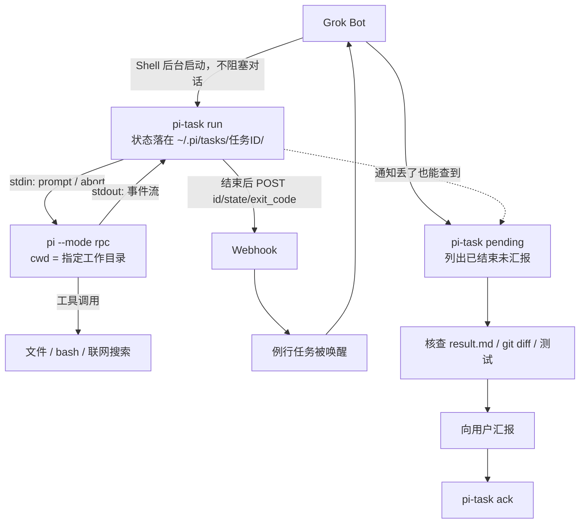

> Hand heavy work from Grok Bot to a local coding agent — and wake the Bot back up when the job is done.

# grokbot-local-agent

一套很小的脚本，让 Grok Bot 把重活交给同一台机器上的本地 Agent，并在任务结束后通过 Webhook 把 Bot 唤醒、核查、汇报。

## 背景与问题

重度使用 Grok Bot 时，订阅套餐消耗得很快。但并不是所有事情都值得让 Bot 自己在云端一轮轮做完：批量改文件、写代码、整理长文档、联网调研，这些“耗轮次”的活交给本地 Agent 更划算。

问题在于，Bot 调用本地 Agent 之后：

- Agent 做完不会给 Bot 回消息，Shell 也不返回任务状态；
- 任务跑得久，Bot 那一轮对话早已结束、进入休眠，就算有输出也没人接收；
- 结果是 Bot 派了活，干得怎么样 Bot 和用户都不知道，Bot 也不会主动回复。

## 解决方案

`bin/pi-task` 把一次性调用包装成“有编号、有状态、有产物”的任务：状态落盘在 `~/.pi/tasks/<任务ID>/`，结束时向 Webhook 发一条只含 `{id, state, exit_code}` 的通知，触发 Bot 的例行任务，让 Bot 在新一轮里回来核查结果。



关键点：通知只是“尽快”的优化，**完成状态永远以磁盘为准**。Webhook 丢了、Bot 重启了、会话被打断了，下次被唤醒时跑一次 `pi-task pending` 就能补齐所有未汇报的任务。

## 限制与 Cursor Cloud Agent 建议

这套方案有一个前提：Grok Bot 的云电脑并不是完全独立的虚拟机沙箱。它能跑 Shell、能装东西，但长程任务的稳定性、环境隔离和权限边界都有限。

所以如果你的目标是让 Bot 调度 Agent 做长时间、多步骤的任务，或者真正写代码并维护一个项目，更推荐直接在 Grok Bot 里拉起 **Cursor Cloud Agent**：它的调度能力、与 Bot 的协作方式都更顺滑，也不需要自己维护通知链路。

这套脚本更适合的定位是：在同一台机器上，让 Bot 有一个便宜、够用的“第二双手”。

## 作者自己的三层分工

1. **Grok Bot**：调度、对话、连接器操作（邮件、GitHub、X 等）、轻量任务，以及对结果的核查和汇报。
2. **本地 Pi Agent**：稍复杂的活——批量改文件、写小脚本、长文初稿、联网调研。通过 `pi-task` 调用，结果落成文件。
3. **Cursor Cloud Agent**：完整、要发布到 GitHub、需要长期迭代的项目，由 Grok Bot 直接拉起。

判断标准很简单：能一两步答完的自己做；要动手改东西的交给 Pi；要长期维护的交给 Cursor Cloud Agent。

## 仓库目录说明

| 路径 | 内容 |
| --- | --- |
| `bin/pi-call.mjs` | 底层 RPC 客户端：启动 `pi --mode rpc`，发一条 `prompt`，等 `agent_settled`，把最后一段回复打到 stdout。Node 22+，零依赖。 |
| `bin/pi-run` | 同步快捷入口，固定模型、`--thinking high`、读写执行工具，适合几十秒的任务。 |
| `bin/pi-task` | 任务化入口的包装脚本。 |
| `bin/pi-task.mjs` | 任务化实现：任务编号、状态/事件/结果落盘，支持续聊、取消、`pending`/`ack`，结束时发通知。 |
| `docs/setup-guide.md` | 完整上手教程：装环境、登录模型、放脚本、建 Webhook 例行任务、端到端验证、常见坑。 |
| `docs/pi-task-reference.md` | `pi-task` 参考文档：子命令、存储结构、状态与退出码、环境变量。 |
| `routines/pi-task-notify.md` | Webhook 例行任务的指令模板，建例行任务时直接粘贴。 |
| `skills/pi-agent/SKILL.md` | 给 Bot 的技能说明：什么时候把活交给 Pi、怎么调用、怎么核查、哪些事不许交给 Pi。 |

## 5 步快速上手

详细命令和排错见 [`docs/setup-guide.md`](docs/setup-guide.md)。

**1. 装 Node 22 和 Pi**（全部装到用户目录，不需要 sudo）

```bash
export PATH=$HOME/.node22/bin:$HOME/.local/bin:$PATH
npm i -g --prefix ~/.local @earendil-works/pi-coding-agent
pi --version && which pi
```

**2. 登录模型**（必须由你本人操作，Bot 不能代登）

在终端运行 `pi`，输入 `/login`，选 **Use a subscription**，按提示完成网页授权。凭据落在 `~/.pi/agent/auth.json`，不要让 Bot 或 Agent 读取它。自检：`pi --list-models deepseek`。

**3. 放置脚本**

```bash
mkdir -p ~/tools/pi-call && cp -a bin/. ~/tools/pi-call/
chmod +x ~/tools/pi-call/pi-run ~/tools/pi-call/pi-call.mjs ~/tools/pi-call/pi-task ~/tools/pi-call/pi-task.mjs
```

`pi-run` 和 `pi-task` 会在自己所在的目录里找对应的 `.mjs`，并把 `$HOME/.local/bin` 加进 `PATH`，所以整个目录放在哪儿都能用；但 `node` 和 `pi` 要能在 `PATH` 里找到（把第 1 步的 `export PATH=...` 写进 `~/.bashrc`）。默认模型写在 `pi-run` 里，换模型改那一行或直接调 `pi-call.mjs`。

**4. 自测一条命令**

```bash
~/tools/pi-call/pi-run /tmp "只回复 OK 两个字母" --timeout 120; echo "exit=$?"
```

预期 stdout 出现 `OK`、`exit=0`。

**5. 建 Webhook 例行任务并验证**

在 Bot 的例行任务面板新建一个 Webhook 触发的任务，指令粘贴 [`routines/pi-task-notify.md`](routines/pi-task-notify.md) 里的模板；然后把 Webhook URL 和 key 通过安全输入框存成 `PI_NOTIFY_URL`、`PI_NOTIFY_SECRET`（不写进任何文件）。跑一条后台任务，确认 `events.jsonl` 里出现 `notify` 事件、例行任务被唤醒并汇报。

最后把 [`skills/pi-agent/SKILL.md`](skills/pi-agent/SKILL.md) 装成 Bot 的技能，或者把里面的规则写进它的系统说明。

## License

MIT，见 [LICENSE](LICENSE)。
