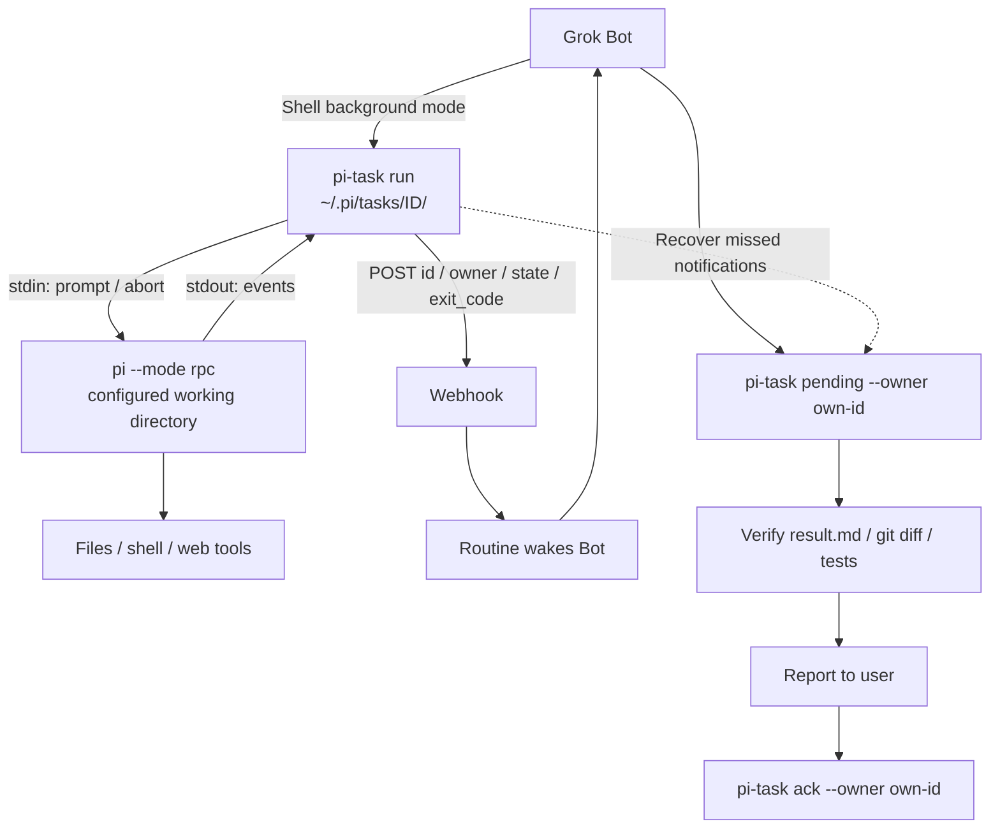

# grokbot-local-agent

Hand heavy work from Grok Bot to a local coding agent—and wake the Bot back up
when the job is done.

English | [简体中文](README.zh-CN.md)

A small set of scripts that lets Grok Bot delegate work to Pi on the **same
machine**, then use a webhook to wake the Bot for verification and reporting.
Here, “local” means local to the Bot's Linux cloud computer, not your personal Mac.

Documentation and agent templates are maintained in English. Bots should still
respond in the user's preferred language.

## Why this exists

Heavy Grok Bot usage can consume a subscription allowance quickly. Batch file
edits, coding, long document drafts and research can instead run through Pi using
the user's separate model account.

Simply starting a background agent is not enough:
- The worker does not automatically send its final answer back to the Bot.
- A long-running task may finish after the Bot's conversation turn has ended.
- Without durable tracking and a wakeup, neither the Bot nor the user knows
  whether the delegated work succeeded.

## How it works

`bin/pi-task` wraps a call in a task with an ID, status and artifacts under
`~/.pi/tasks/<ID>/`. On completion it sends only
`{source, id, owner, state, exit_code}` to a webhook. A routine wakes the Bot,
which reads the files, verifies the outcome, reports it and acknowledges the task.

Each task records the dispatching Bot's agent ID using `run --owner <agent-id>`
or `PI_TASK_OWNER`. If neither is supplied, owner is null and a warning is emitted.
Owner-filtered `pending`, `list` and `ack` help keep Bots from reporting each
other's work. Always pass `--owner` when acknowledging: an unfiltered ack does
not enforce ownership.



Notifications optimize latency; **disk state is the source of truth**.
After a missed webhook, restart or interrupted conversation, the next wakeup can
recover unreported outcomes using `pi-task pending`. Do not rerun work just
because a notification was missed.

## Scope and limitations

This is a lightweight second pair of hands on the Bot's machine, not an isolated
worker service. Do not assume the cloud computer provides a dedicated VM sandbox,
unlimited process lifetime or strong permission isolation.

The author's workflow uses three layers:
1. Grok Bot: conversation, orchestration, connectors and verification.
2. Pi: batch edits, small scripts, drafts and research.
3. Cursor Cloud Agent, when available: larger projects intended for ongoing
   development and GitHub delivery.

That is a workflow preference, not a requirement or guarantee of any provider's
features. Long-running project work may be better served by a dedicated cloud
coding environment than by maintaining this notification chain.

## Repository layout

| Path | Purpose |
| --- | --- |
| `bin/pi-call.mjs` | One-shot RPC client: starts Pi, sends a prompt, waits for agent_settled and prints the final reply. Node 22+, no third-party dependencies. |
| `bin/pi-run` | Synchronous shortcut with a fixed model, high thinking and read/write/exec tools. |
| `bin/pi-task`, `bin/pi-task.mjs` | Tracked tasks, ownership, follow-up turns, cancellation, pending/ack and completion notification. |
| [Setup guide](docs/setup-guide.md) | Installation, model login, webhook setup, acceptance and troubleshooting. |
| [CLI reference](docs/pi-task-reference.md) | Commands, storage, states, exit codes and environment variables. |
| [Routine template](routines/pi-task-notify.md) | Owner-aware completion handling. |
| [Pi skill](skills/pi-agent/SKILL.md) | Delegation, verification and permission boundaries. |

## Quick start

Run these steps on the Bot's computer. See the [setup guide](docs/setup-guide.md)
for details. UI labels, provider availability and approvals may vary by host.

### 1. Prepare Node 22+ and install Pi

Install Node in your user environment if it is not already available; the PATH
below assumes a Node installation at ~/.node22. No sudo is needed.

```bash
export PATH=$HOME/.node22/bin:$HOME/.local/bin:$PATH
node --version
npm i -g --prefix ~/.local @earendil-works/pi-coding-agent
pi --version && which pi
```

### 2. Authenticate the model yourself

Run `pi` in an interactive terminal, enter `/login`, select the subscription
option/provider offered by your installation, and complete the authorization.
Do not ask an agent to inspect or copy `~/.pi/agent/auth.json`.
`pi --list-models deepseek` lists models without exposing credentials; the smoke
test below checks actual execution.

The current default is `deepseek/deepseek-flash`. Choose a model available to
your account; `pi-task run --model provider/model` supports overrides.

### 3. Copy the scripts

From this repository:

```bash
mkdir -p ~/tools/pi-call && cp -a bin/. ~/tools/pi-call/
chmod +x ~/tools/pi-call/pi-run ~/tools/pi-call/pi-call.mjs ~/tools/pi-call/pi-task ~/tools/pi-call/pi-task.mjs
```

Wrappers locate their .mjs files beside themselves and add ~/.local/bin to PATH.
Ensure both node and pi are available to the Bot's shell. Persist the appropriate
PATH in your shell setup. The fixed pi-run model is set in that wrapper.

### 4. Run a smoke test

```bash
~/tools/pi-call/pi-run /tmp "Reply with only OK" --timeout 120
echo "exit=$?"
```

Expect OK and exit=0.

### 5. Configure and verify a webhook routine

Create a webhook-triggered routine using the [template](routines/pi-task-notify.md).
Store its URL and raw Bearer token using the host's secure input facility as
`PI_NOTIFY_URL` and `PI_NOTIFY_SECRET`, not in files or prompts.

Dispatch with `--owner YOUR_AGENT_ID`; obtain your Bot's ID from its profile
location, such as /home/box/agent-data/agents/YOUR_AGENT_ID/profile.json.
Run the [end-to-end check](docs/setup-guide.md#5-end-to-end-check) and verify
both the notify event and the Bot's verified report.

Install [skills/pi-agent/SKILL.md](skills/pi-agent/SKILL.md) as a Bot skill, or
include its rules in the Bot's instructions.

## License

[MIT](LICENSE).
