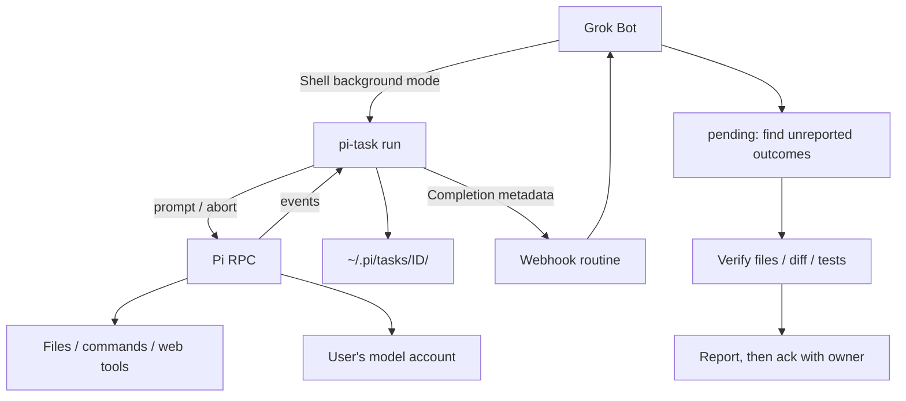

# Delegate work from Grok Bot to Pi: setup guide

[Project overview](../README.md) · [中文简介](../README.zh-CN.md)

Prerequisites: a Grok Bot Linux computer with shell access, routines that can be
triggered by webhook, and a secure facility for supplying environment variables.
UI labels and available features may vary. Pi runs on that same cloud computer,
not on your personal laptop. User-facing replies should use the user's language.

The goal: delegate file processing, coding, drafts or research, then wake the Bot
to verify and report the result without keeping the conversation turn open.

## 1. Lifecycle

The Bot starts pi-task with its Shell tool's background mode. pi-task starts
`pi --mode rpc` and exchanges JSONL over stdin/stdout. Status, events, prompts
and results are saved under `~/.pi/tasks/<ID>/`.



- Start: stdout begins with `TASK <ID>`. Supply `--owner YOUR_AGENT_ID` so the
  completion can be routed back to the dispatching Bot. The fallback is
  PI_TASK_OWNER; without either, owner is null and the command warns.
- Execute: Pi works in the specified directory and records its progress.
- Finish: the final reply is written to result.md, when available. The notifier
  POSTs only `{source, id, owner, state, exit_code}`, never the prompt or result.
- Wake: the receiving Bot examines pending tasks and their owners, verifies its
  own results, reports them and runs ack with its own owner ID.
- Recover: notifications are best-effort. Disk state remains authoritative.

A background shell command finishing does not itself guarantee a new Bot turn.
The original conversation may already have ended. Webhooks can also be missed;
check pending on subsequent wakeups rather than reexecuting the task.

## 2. Install and authenticate

Run commands on the Bot computer. Check existing tools before installing.

### 2.1 Node 22+ and Pi

Install Node in a user directory using your environment's supported method if
needed. The following PATH assumes Node is installed at ~/.node22; it does not
install Node itself. All installation here is user-local, without sudo.

```bash
export PATH=$HOME/.node22/bin:$HOME/.local/bin:$PATH
node --version
npm i -g --prefix ~/.local @earendil-works/pi-coding-agent
pi --version && which pi
```

Make the PATH available to future Bot shell sessions as well.

### 2.2 Model login: user-operated

Run `pi` in an interactive terminal and enter `/login`. Select the subscription
login and provider supported by your installation, then complete browser
authorization. If instructed, paste the authorization code or callback URL into
the login terminal—not into the Bot conversation.

Credentials are stored in `~/.pi/agent/auth.json`. Do not have the Bot or delegated
agent inspect, print or copy that file. The Pi runtime handles authentication
internally; this restriction concerns exposing credentials through agent tools.

`pi --list-models deepseek` checks the available model catalog without displaying
credentials. Listing a model does not prove that a request will authenticate;
use the smoke test to verify actual execution.

The default model in pi-run and pi-task is `deepseek/deepseek-flash`. For another
account/model, edit the pi-run wrapper's model or use pi-call directly; pi-task
supports `run --model provider/model`. Do not assume every provider/account has
this particular model or subscription login option.

### 2.3 Copy the scripts

From the repository root:

```bash
mkdir -p ~/tools/pi-call && cp -a bin/. ~/tools/pi-call/
chmod +x ~/tools/pi-call/pi-run ~/tools/pi-call/pi-call.mjs ~/tools/pi-call/pi-task ~/tools/pi-call/pi-task.mjs
```

| Entry point | Purpose |
| --- | --- |
| pi-call.mjs | One-shot RPC client. Sends a prompt, waits for agent_settled, prints the final reply. |
| pi-run | Synchronous shortcut with a fixed model, high thinking and write/exec tools enabled. |
| pi-task + pi-task.mjs | Persistent task IDs, ownership, events/results, follow-up, cancellation and notifications. |

The wrappers locate .mjs files beside themselves and add ~/.local/bin to PATH.
Keep the files together and ensure node and pi can be found. See the
[CLI reference](pi-task-reference.md) for task storage and command details.

### 2.4 Smoke test

```bash
~/tools/pi-call/pi-run /tmp "Reply with only OK" --timeout 120
echo "exit=$?"
```

Expect OK on stdout and exit=0. If it fails, check Node/Pi availability, model
access and the error message; for tracked tasks also check task-store permissions.

## 3. Create the webhook routine

Create a webhook-triggered routine in the Bot's routine interface, using a name
such as “Pi task completion”. Paste the instructions from
[the routine template](../routines/pi-task-notify.md), replacing YOUR_AGENT_ID
with the receiving Bot's actual ID.

The template distinguishes three cases:

1. Your tasks: verify the result, report it to the user, then ack with your owner ID.
2. Another Bot's tasks: forward ID/owner/state to that Bot using SendToAgent with
   priority true; do not inspect, report or ack on its behalf. If the routine
   cannot forward messages, return the routing information to the main Bot.
3. Unowned tasks: tell the user the owner is missing; do not verify or ack.

The metadata-only notification cannot describe what the task actually did.
Read pending/status and the result files. The Bot's own ID can be found in its
profile path, such as `/home/box/agent-data/agents/YOUR_AGENT_ID/profile.json`.

## 4. Supply notification credentials securely

Find the routine's webhook URL and key in the host interface. Use the secure
input facility to supply:

| Variable | Value |
| --- | --- |
| PI_NOTIFY_URL | Webhook endpoint URL |
| PI_NOTIFY_SECRET | Raw Bearer token/key, without a Bearer prefix |
| PI_TASK_OWNER | Optional default dispatching Bot ID; explicit --owner is preferable |

- Do not put secrets in scripts, task files, a repository, prompts or command-line arguments.
- Verify the endpoint accepts `Authorization: Bearer ...`; do not confuse a
  Bearer token with a provider-specific signing secret.
- The Bot shell must inherit these environment variables. The notifier skips
  sending if either URL or secret is absent, or PI_NOTIFY_OFF=1.
- The secret is sent in the Authorization header, not recorded in task metadata.

## 5. End-to-end check

Replace YOUR_AGENT_ID and TASK_ID below; they are placeholders, not literal IDs.
Use the Bot Shell tool's own background mode for the run command, not nohup,
`&` or setsid.

```bash
test -n "$PI_NOTIFY_URL" && test -n "$PI_NOTIFY_SECRET" && echo env-ok

~/tools/pi-call/pi-task run /tmp "Create /tmp/pi-e2e if needed, write hello to /tmp/pi-e2e/out.txt, then reply done" \
  --session e2e --owner YOUR_AGENT_ID --timeout 180 > /tmp/pi-e2e.log 2>&1
```

In another shell action, inspect the first line to obtain the task ID:

```bash
head -1 /tmp/pi-e2e.log
~/tools/pi-call/pi-task status TASK_ID
grep notify ~/.pi/tasks/TASK_ID/events.jsonl
```

| Check | Expected |
| --- | --- |
| Task record | state=done, exit_code=0 in status.json, correct owner and result.md present |
| events.jsonl | A notify event, typically text="http 200", after completion |
| Routine | Wakes and reports verified task ID, status, conclusion and artifact location |
| pending | Task disappears after report + ack; reported=true in status |

The human-readable status command does not currently print exit_code directly;
inspect status.json when that field is needed. Do not edit it manually.

If no notification arrives, check environment availability and the routine's
configuration privately. The task result is still on disk. Use pending to
finish reporting; a failed notification is not a reason to rerun the task.

## 6. Install the Bot skill

Install [skills/pi-agent/SKILL.md](../skills/pi-agent/SKILL.md) using your host's
skill mechanism, or include its rules in the Bot's instructions. It covers:

- Short, self-contained prompts with input/output paths and acceptance criteria.
- Explicit owner IDs and the Shell tool's background mode.
- Checking pending on wakeup, independently verifying results and owner-filtered ack.
- Continuing with reply in the same task/session rather than starting over.
- Keeping credential access, publishing, deployment and other sensitive actions
  out of delegated work.

English instructions do not require English replies: the Bot and Pi should use
the user's preferred language unless the task explicitly requests another.

## 7. Command summary

| Command | Behavior |
| --- | --- |
| run cwd prompt --session name --owner id | Creates a task; prints TASK ID, then STATE and RESULT on completion |
| reply ID prompt | Follows up in the same session/directory with the same owner/options |
| status ID | Displays state, owner, model, directory, timing, runs and recent events |
| list [--all] [--owner id\|none] | Running and recent tasks, optionally owner-filtered |
| log ID [-n 30] | Recent events |
| cancel ID | SIGTERM, then forced cancellation after 12 seconds if needed |
| pending [--owner id\|none] | Terminal tasks not yet reported |
| ack ID [ID...] [--owner id\|none] | Marks reported; with a filter, refuses mismatched owners |

Run supports --timeout (default 300 seconds; 0 disables it), --model, --thinking,
--no-write and --no-web. Exit codes: 0 done, 1 failed/refused, 2 usage error,
124 timeout, 130 cancelled. See the reference for storage and recovery details.

## 8. Troubleshooting

- After a restart, home storage may take time to become available. Check
  `ls ~/tools/pi-call/` before repeatedly launching tasks. Commands detect
  formerly running tasks whose process has disappeared and mark them interrupted.
- Missing tasks: a test PI_TASK_DIR may still be set. `unset PI_TASK_DIR` returns
  to ~/.pi/tasks; do not discard the alternative store's results.
- Rotated webhook key: update PI_NOTIFY_SECRET via secure input and repeat an
  explicitly authorized smoke test.
- No notification: inspect notify events and pending; do not automatically rerun.
- Occupied session: only one running task per session is allowed. Check status,
  cancel if appropriate, or choose a different session.
- Timeout: split work or increase --timeout. Failed work needs a verified reason
  and user approval before retrying; avoid repeated empty calls.
