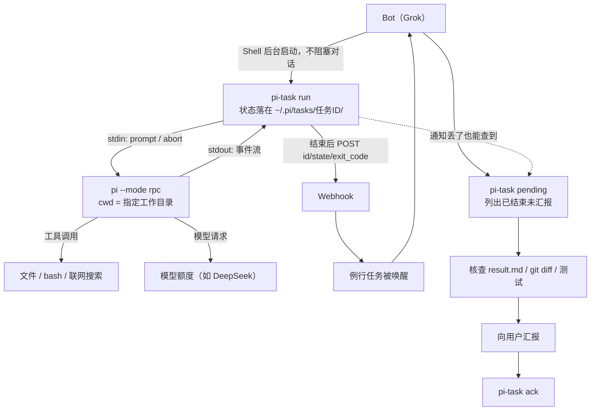

# 让 Grok Bot 把重活交给 Pi Agent（上手教程）

适用前提：你的 Grok Bot 有一台 Linux 云电脑，能执行 Shell 命令，有例行任务功能，例行任务可被 Webhook 触发，并且能用安全输入框把密钥存成环境变量。
目标：Bot 把批量改文件、写代码、长文初稿、联网调研这类重活交给同一台电脑上的 Pi Agent；任务结束后 Bot 被自动唤醒，核查结果再向你汇报，全程不用你守在终端前。

---

## 1. 整体机制

Bot 不直接操作 Pi 的交互界面，而是用 Shell 后台启动 `pi-task`；`pi-task` 再启动 `pi --mode rpc` 子进程，通过 stdin/stdout 的 JSONL 协议对话。任务状态、事件流和结果都写在 `~/.pi/tasks/<任务ID>/` 里。



- **启动**：`pi-task run` 第一行输出 `TASK <任务ID>`，之后 Bot 就能继续跟你说话。
- **执行**：Pi 在指定工作目录里读写文件、跑命令、联网；每轮提示词、工具调用、状态都落盘。
- **结束**：`pi-task` 把 `result.md` 写好，然后向 `PI_NOTIFY_URL` 发一条只含 `id`、`state`、`exit_code` 的 POST。
- **唤醒**：Webhook 触发例行任务，Bot 在新一轮里跑 `pi-task pending`，核查、汇报、`ack`。
- **兜底**：通知只是“尽快”的优化，真正的完成状态在磁盘上；任何时候被唤醒都先查 `pending`。

### 为什么不能只靠后台命令的完成通知

1. Bot 的 Shell 后台任务只属于“当前这一轮对话”。一轮结束后 Bot 就被回收，命令跑完也没有人在等结果。
2. 后台命令结束不会主动唤醒一个睡着的 Bot。能唤醒它的只有用户消息或例行任务（Webhook）。
3. 通知本身也可能丢：投递失败、Bot 重启、会话被打断、Webhook 并发排队。所以完成状态必须落盘，`pending` 才是事实来源。

---

## 2. 搭建步骤

以下命令都在 Bot 电脑的终端里执行（Bot 通过自己的 Shell 工具执行也可以）。顺序不要颠倒。

### 2.1 装 Node 22 和 Pi

全部装到用户目录，不需要 sudo：

```bash
# Node 22 装到 ~/.node22（nvm 或官方二进制均可）
export PATH=$HOME/.node22/bin:$HOME/.local/bin:$PATH
npm i -g --prefix ~/.local @earendil-works/pi-coding-agent
pi --version && which pi
```

新开 shell 里找不到 `pi`，先执行上面的 `export PATH=...`。

### 2.2 登录模型（由你本人操作）

在 Bot 电脑的终端里运行 `pi`，输入 `/login`，选 **Use a subscription**，选服务商（以 DeepSeek 为例），按提示完成网页授权；终端没自动接上时，把授权码或跳转后的网址粘回终端。

- 凭据落在 `~/.pi/agent/auth.json`，**Bot 和 Pi 都不许读取、输出或复制它**；登录必须你本人做，Bot 不能代登。
- 自检登录是否有效（只列模型，不暴露凭据）：`pi --list-models deepseek`，能列出 `deepseek-flash` 之类的模型即可。

### 2.3 放置脚本

把本仓库 `bin/` 目录里的脚本拷贝到 `~/tools/pi-call/`：

```bash
mkdir -p ~/tools/pi-call && cp -a bin/. ~/tools/pi-call/
chmod +x ~/tools/pi-call/pi-run ~/tools/pi-call/pi-task ~/tools/pi-call/pi-task.mjs
```

三个入口，作用分别是：

| 文件 | 作用 |
| --- | --- |
| `pi-call.mjs` | 底层 RPC 客户端。启动 `pi --mode rpc`，发一条 `prompt`，等 `agent_settled`，把最后一段回复打到 stdout。Node 22+ 零依赖单文件。 |
| `pi-run` | 同步快捷入口。bash 包装，固定模型、`--thinking high`、读写执行工具；几十秒能完成的任务前台直接跑。 |
| `pi-task` + `pi-task.mjs` | 任务化入口。包装脚本 + 实现：给任务编号、落盘状态/事件/结果，支持续聊、取消、`pending`/`ack`，结束时发通知。 |

设计与用法说明见仓库里的 `docs/pi-task-reference.md`，排错时看。

注意：`pi-run`、`pi-task` 两个包装脚本用 `$here` 定位同目录的 `.mjs`，并假设 `pi` 在 `~/.local/bin` 或已在 `PATH` 里；装到别处就改脚本里的 `export PATH=...`。默认模型写在 `pi-run` 里，换模型就改它或直接调 `pi-call.mjs`。

### 2.4 自测一条命令

```bash
~/tools/pi-call/pi-run /tmp "只回复 OK 两个字母" --timeout 120; echo "exit=$?"
```

预期：stdout 出现 `OK`，`exit=0`。失败按顺序查：`pi --version` 是否可用、`pi --list-models deepseek` 是否有效、`~/.pi/tasks` 是否可写。

---

## 3. 建 Webhook 例行任务

在 Bot 的例行任务面板新建一个任务，触发方式选 **Webhook**，名字随意（例如「Pi 任务完成通知」），指令直接粘贴下面这段（同一份模板也放在仓库的 `routines/pi-task-notify.md`）：

```text
你是值班助手。收到 Pi 任务完成通知后，按以下步骤处理：

1. 先运行 ~/tools/pi-call/pi-task pending，列出所有已结束但未汇报的任务。
   没有任何输出就只回复“无待汇报任务”，不要发消息给用户，结束。
2. 对每个任务：pi-task status <ID> 看状态和退出码；读 ~/.pi/tasks/<ID>/result.md，
   必要时看 events.jsonl 或 log；用 git diff、跑测试、读产物核查 Pi 真的做了它说的事。
3. 汇报任务 ID、状态（done/failed/cancelled/interrupted）、一句话结论、核查了什么、
   产物路径。失败或超时说明原因并问是否重跑，不要自动重跑。
4. 核查并汇报完成后执行 pi-task ack <ID>；核查没通过就保留 pending 并说明卡在哪。
5. 除了 `pi-task ack` 之外，不要手动修改 ~/.pi/tasks 下的文件，不读取任何密钥或 auth.json，
   不替用户推送、部署或对外发消息。
```

通知体只含 `{source, id, state, exit_code}`，不含提示词和结果，所以必须靠 `pending` + 读文件才能知道干了什么。

---

## 4. 用安全输入框存两个环境变量

在例行任务面板里找到刚建的任务，复制它的 **Webhook URL** 和 **Webhook key**（或签名密钥）。然后在 Bot 的安全输入框里创建两个环境变量：

| 变量名 | 值 |
| --- | --- |
| `PI_NOTIFY_URL` | 刚复制的 Webhook URL |
| `PI_NOTIFY_SECRET` | 刚复制的 Webhook key |

要求：

- 只通过安全输入框保存，**不要**写进脚本、任务文件、仓库或提示词，也不要出现在命令行参数里。
- Bot 的 Shell 会继承这两个变量；`pi-task` 只在环境里同时存在两者时才发通知，否则静默跳过。
- 发通知时密钥只放在 `Authorization: Bearer ...` 请求头里，不落盘。

---

## 5. 端到端验证

```bash
test -n "$PI_NOTIFY_URL" && test -n "$PI_NOTIFY_SECRET" && echo env-ok

# 后台跑一个小任务（用 Bot Shell 的后台模式，不要 nohup / & / setsid）
~/tools/pi-call/pi-task run /tmp "把 hello 写进 /tmp/pi-e2e/out.txt，然后回复 done" \
  --session e2e --timeout 180 > /tmp/pi-e2e.log 2>&1
head -1 /tmp/pi-e2e.log        # TASK e2e-<时间戳>
~/tools/pi-call/pi-task status e2e-<时间戳>
grep notify ~/.pi/tasks/e2e-<时间戳>/events.jsonl
```

预期结果：

| 检查点 | 预期 |
| --- | --- |
| `status` | `state=done`、`exit_code=0`，`result.md` 已生成 |
| `events.jsonl` | 十几秒内出现 `{"type":"notify","text":"http 200"}` |
| 例行任务 | 被 Webhook 唤醒，在聊天里汇报任务 ID、状态、结论和产物 |
| `pending` | 汇报并 `ack` 后为空；`status` 里 `reported=true` |

若 `notify` 显示 `error ...` 或一直没出现，先确认两个环境变量对 Bot 的 shell 可见，再检查 Webhook URL、key 和例行任务是否启用。**通知失败不影响任务本身**，手工 `pi-task pending` 仍能收尾。

---

## 6. 给 Bot 的使用规则

把下面这段存成技能，或直接写进 Bot 的系统说明（仓库里已整理成 `skills/pi-agent/SKILL.md`，可直接装用）：

```text
重活交给本机 Pi Agent，用 ~/tools/pi-call/pi-task。适用：批量文件处理、写代码、
长篇调研/联网搜索、长文初稿、用户点名要 Pi 做或要第二意见。短问答和连接器操作自己做。

启动：pi-task run <工作目录> "<提示词>" --session <英文kebab名> [--timeout 秒]
用 Shell 工具自带的后台模式，不要 nohup、&、setsid；记下第一行的 TASK <ID>。
提示词短而完整：目标、输入路径、输出文件、完成标准，长材料给路径让 Pi 自己读。

每次被唤醒（用户消息、例行任务）：只要派过任务，先跑 pi-task pending。
每个已结束任务：status + 读 result.md + git diff/测试/读产物核查，再向用户汇报，
然后 pi-task ack <ID>。失败先说明原因并问是否重跑，不要自动重跑。
接着改：pi-task reply <ID> "<要改什么>"（同一会话、同一目录）。
超时就拆小或加大 --timeout；同一会话同时只能有一个 running 任务。

规则：不让 Pi 读 auth.json、密钥文件或环境变量里的 key；推送、部署、改线上、
对外发消息/邮件、删除重要文件由 Bot 自己做并先征得用户同意；回复用户时说明
“让 Pi 做了 X”以及自己核查了什么。
```

---

## 7. `pi-task` 速查

| 子命令 | 作用 |
| --- | --- |
| `run <cwd> "<提示词>" --session <名>` | 新建任务；stdout 第一行 `TASK <ID>`，结束打印 `STATE`、`RESULT` |
| `reply <ID> "<提示词>"` | 同一会话、同一目录追加一轮（沿用 thinking/权限设置） |
| `status <ID>` | 状态、模型、cwd、耗时、轮数、`reported`、最近事件 |
| `list [--all]` | 默认列 running + 最近 24 小时的任务 |
| `log <ID> [-n 30]` | 最近 n 条事件（工具调用、重试、通知等） |
| `cancel <ID>` | 先 SIGTERM，12 秒未停则 SIGKILL 并记 `cancelled` |
| `pending` | 已结束但 `reported=false` 的任务，附 `result.md` 路径 |
| `ack <ID> [<ID>...]` | 标记 `reported=true` |

`run` 还支持 `--timeout 秒`（`0` 表示不超时）、`--model provider/model`、`--thinking off|low|medium|high`、`--no-write`、`--no-web`。

| 退出码 | 含义 |
| --- | --- |
| `0` | `done` |
| `1` | `failed`，原因见 `status.error`；参数/会话占用等拒绝也是 1 |
| `2` | 用法错误（缺参数、未知选项、非法 `--timeout`） |
| `124` | 超时（`failed`，`error=timeout`） |
| `130` | 被取消（`cancelled`） |

任务目录 `~/.pi/tasks/<任务ID>/`：`status.json`（原子写入）、`events.jsonl`、`result.md`（取消或失败发生在任何回复之前时不存在）、`prompt-<n>.txt`。

---

## 8. 常见坑

1. **重启后脚本“消失”或 Pi 立刻报错**：`/home` 往往要几分钟才恢复挂载。先 `ls ~/tools/pi-call/` 确认可读再调用，别反复空跑；重启前在跑的任务会被标成 `interrupted`。
2. **`pending` / `list` 看不到刚跑的任务**：Shell 残留了测试用的 `PI_TASK_DIR`，`unset PI_TASK_DIR` 回到 `~/.pi/tasks`。
3. **Webhook key 轮换后通知全失败**：环境变量还是旧 key，让用户用安全输入框重填 `PI_NOTIFY_SECRET`，再跑一次第 5 节。
4. **通知失败/没收到**：不要重跑任务。看 `events.jsonl` 的 `notify` 行，结果仍在磁盘上，用 `pending` 补汇报。
5. **同一会话报 occupied / still running**：同一 `--session` 只允许一个 running 任务，先 `status`，必要时 `cancel`，或换会话名。
